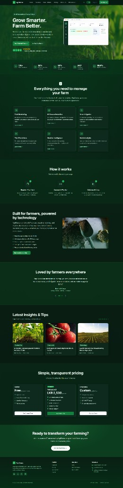
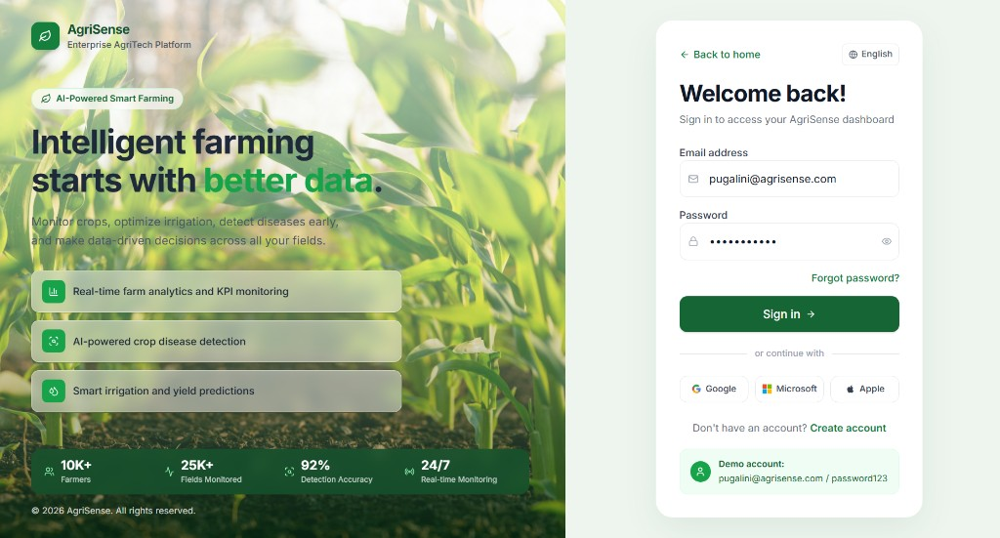
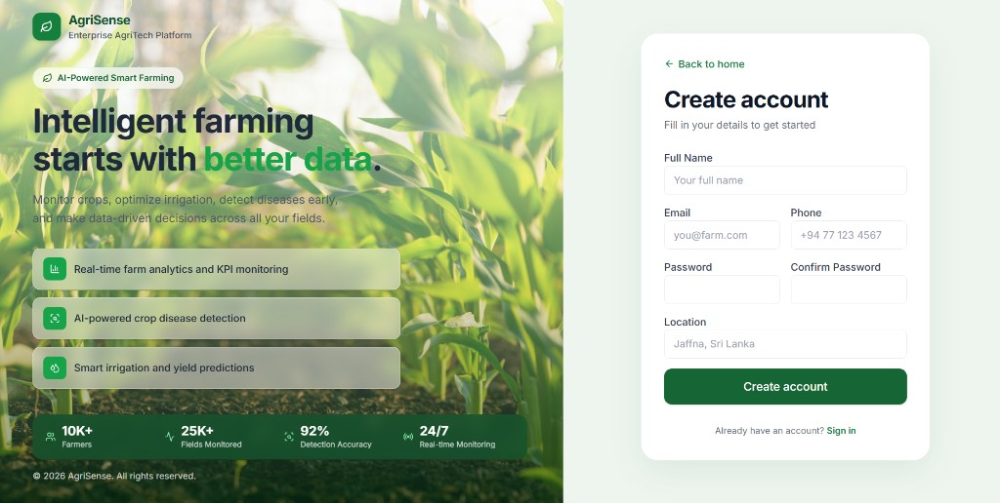
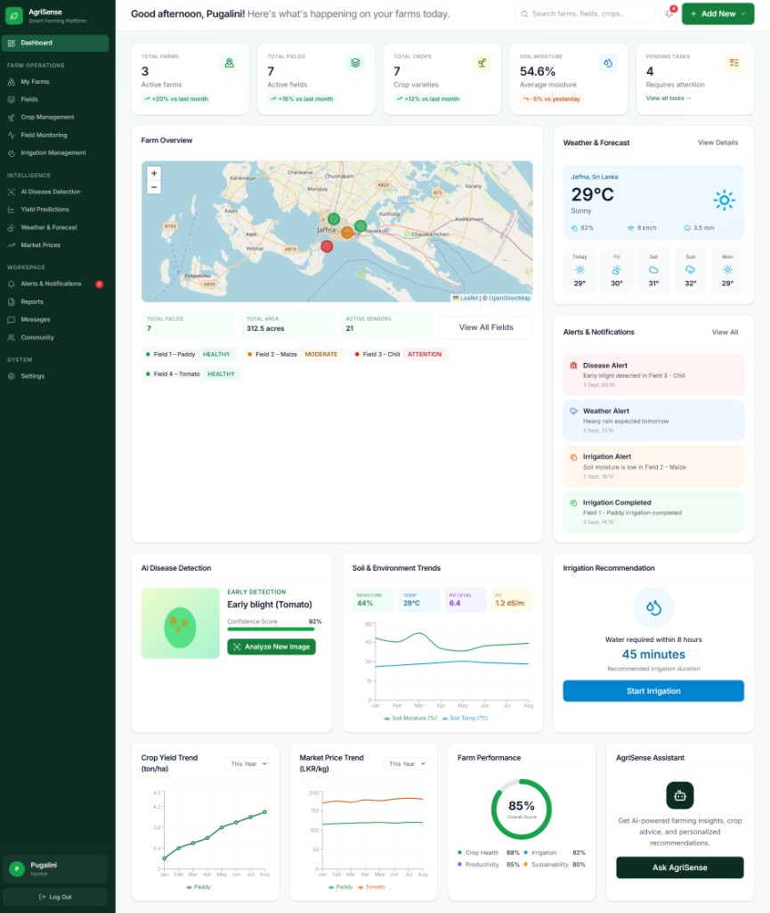
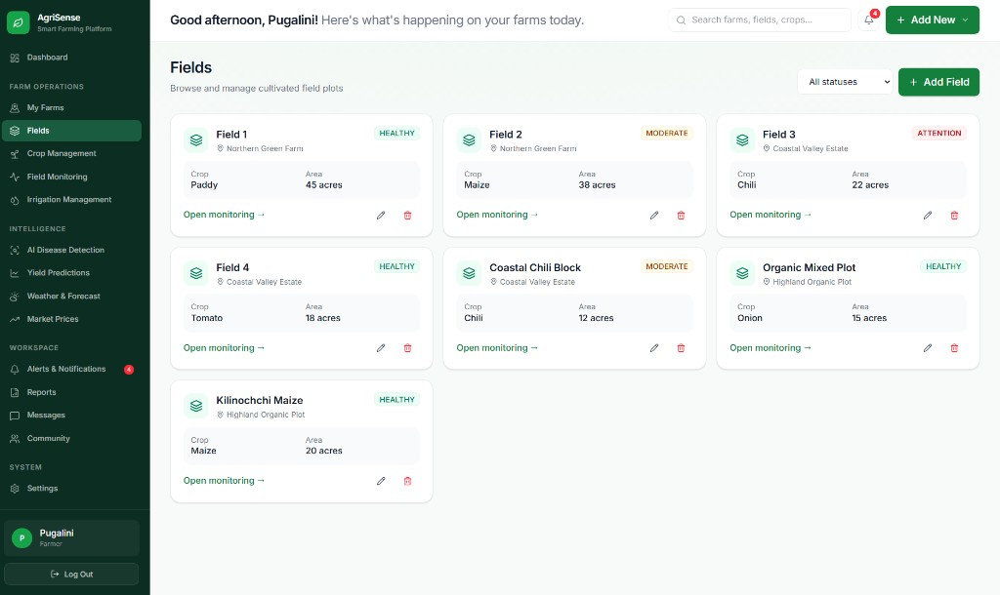
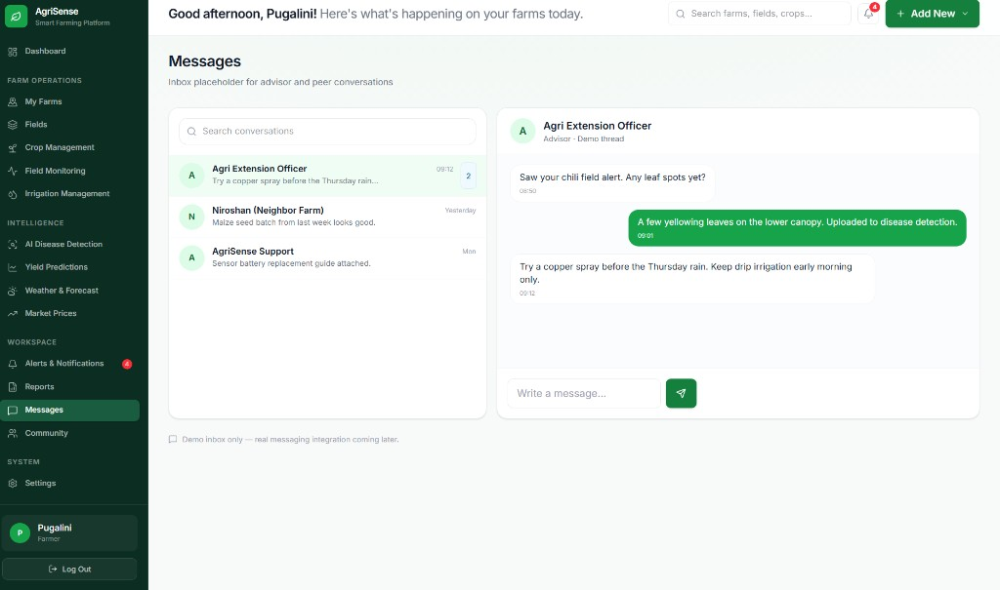

# AgriSense

Full-stack AgriTech dashboard for farm, field, and crop monitoring — React, Spring Boot (JWT), FastAPI, and PostgreSQL.

Farmers can register, manage farms and fields, track crops, view weather and market prices, and use irrigation and disease-detection tools from one dashboard.

## Screenshots

### Landing page



### Login



### Register



### Dashboard



### Fields



### Messages



## Architecture

```
React (Vite)  →  Spring Boot REST / JWT / WebSocket  →  PostgreSQL (or H2)
                         ↓
                  FastAPI AI service (disease detection)
```

| Layer | Stack |
|-------|--------|
| Frontend | React 19, TypeScript, Vite, Tailwind CSS, React Router, Recharts, Leaflet |
| Backend | Java 21, Spring Boot 3, Spring Security + JWT, Spring Data JPA, SSE/WebSocket |
| AI service | Python, FastAPI; mock predictor (optional PyTorch model via `MODEL_PATH`) |
| Database | PostgreSQL 16 (Docker) or H2 for local/dev |

## Features

- Public landing page and JWT auth (register / login)
- Dashboard with KPIs, farm map, weather, alerts, and charts
- Farms, fields, and crops — full CRUD
- Field monitoring with sensor readings (SSE / polling)
- Image-based disease detection (Spring Boot → FastAPI)
- Irrigation recommendations and start-irrigation flow
- Weather forecast, yield predictions, and market prices
- Backend tests for JWT, auth, and farm/field APIs

## Project structure

```
agrisense/
├── frontend/           # React dashboard + landing page
├── backend/            # Spring Boot API
├── ai-service/         # FastAPI disease detection
├── docs/screenshots/   # UI screenshots
├── docker-compose.yml  # PostgreSQL
└── README.md
```

## Prerequisites

- Node.js 20+
- Java 21 and Maven 3.9+
- Python 3.11+
- Docker (for PostgreSQL) — optional if you use the H2 local profile

## Quick start

### 1. Database (optional)

```bash
docker compose up -d
```

Postgres: `localhost:5432`, database `agrisense`, user/password `postgres`.

### 2. Backend

**PostgreSQL**

```bash
cd backend
mvn spring-boot:run
```

**H2 (no Docker required)**

```bash
cd backend
mvn spring-boot:run -Dspring-boot.run.profiles=local
```

API: http://localhost:8080

Demo data is seeded on first boot.

**Tests**

```bash
cd backend
mvn test
```

### 3. AI service

```bash
cd ai-service
python -m venv .venv

# Windows
.venv\Scripts\activate

# macOS / Linux
source .venv/bin/activate

pip install -r requirements.txt
uvicorn app.main:app --reload --host 0.0.0.0 --port 8000
```

Health: http://localhost:8000/health

No trained model is bundled. The service uses a mock predictor unless `MODEL_PATH` points to a `.pt` file.

### 4. Frontend

```bash
cd frontend
npm install
npm run dev
```

App: http://localhost:5173 (or the next free port Vite prints)

## Demo login

| Field | Value |
|-------|--------|
| Email | `pugalini@agrisense.com` |
| Password | `password123` |

## Environment

**Frontend** (`frontend/.env`)

```env
VITE_API_URL=http://localhost:8080/api
VITE_WS_URL=http://localhost:8080/ws
```

**Backend**

| Variable | Default | Purpose |
|----------|---------|---------|
| `POSTGRES_PASSWORD` | `postgres` | Database password |
| `JWT_SECRET` | local default | Change this before any real deploy |
| `agrisense.ai-service-url` | `http://localhost:8000` | FastAPI base URL |

**AI service**

| Variable | Purpose |
|----------|---------|
| `MODEL_PATH` | Optional path to a trained `.pt` model |

## API

```
POST   /api/auth/register
POST   /api/auth/login
GET    /api/dashboard/stats
GET|POST|PUT|DELETE  /api/farms
GET|POST|PUT|DELETE  /api/fields
GET|POST|PUT|DELETE  /api/crops
GET    /api/sensors/{fieldId}/readings
GET    /api/sensors/stream/{fieldId}   (SSE)
GET    /api/weather
GET    /api/market-prices
POST   /api/disease-detection
POST   /api/yield-prediction
GET    /api/irrigation/recommendation
POST   /api/irrigation/start
GET    /api/alerts
```

WebSocket: `/ws` → `/topic/sensors/{fieldId}`

AI service: `POST /predict`, `GET /health`

## License

MIT
